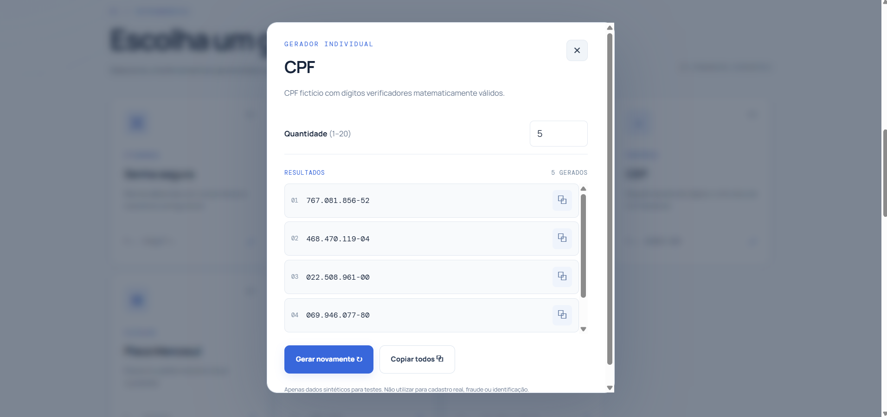

<div align="center">

# ✳ ForgeData

### Dados de teste. Sem complicação.

**Uma central de geradores de dados sintéticos para desenvolvimento, prototipagem e testes de interfaces.**

[](https://developer.mozilla.org/pt-BR/docs/Web/HTML)
[](https://developer.mozilla.org/pt-BR/docs/Web/CSS)
[](https://developer.mozilla.org/pt-BR/docs/Web/JavaScript)


[**Repositório**](https://github.com/DevElydeivison/Geradores) · [**LinkedIn**](https://www.linkedin.com/in/elydeivisoncesar/)

</div>

---

## 📌 Sobre o projeto

O **ForgeData** é uma aplicação web front-end que reúne **sete geradores individuais** e uma ferramenta de **identidade fictícia**, que combina diferentes informações em um único perfil de teste.

O objetivo é facilitar a criação de dados de exemplo para preencher formulários, validar componentes visuais, demonstrar funcionalidades e estudar conceitos de desenvolvimento web. A aplicação utiliza **HTML, CSS e JavaScript com ES Modules**, sem necessidade de cadastro, backend ou banco de dados.

A interface adota uma estética **clean**, com fundo claro, cartões organizados, detalhes em azul e navegação responsiva.

## 🖥️ Visão geral da interface


## 🧰 Funcionalidades

| Ferramenta | O que gera |
| --- | --- |
| 🔐 **Senha segura** | Senhas com comprimento configurável e seleção de maiúsculas, minúsculas, números e símbolos |
| 🪪 **CPF** | Sequências de CPF com dígitos verificadores matematicamente válidos |
| 📱 **Telefone** | Números de celular formatados no padrão brasileiro, com DDD |
| 📍 **CEP** | Sequências de oito dígitos formatadas como CEP brasileiro |
| 🚘 **Placa Mercosul** | Placas no formato brasileiro `LLLNLNN` |
| 🚗 **Placa antiga** | Placas no formato anterior `LLL-NNNN` |
| 👤 **Nome completo** | Combinações de nomes e sobrenomes brasileiros |
| 🧩 **Identidade fictícia** | Um perfil sintético reunindo nome, CPF, senha, telefone, CEP e os dois formatos de placa |

Nos geradores individuais, é possível gerar **de 1 a 20 resultados por vez**, copiar cada resultado separadamente ou copiar todos de uma só vez.

### Catálogo de geradores


### Gerador de senhas

Permite definir a quantidade de senhas, ajustar o comprimento e escolher os grupos de caracteres utilizados.


### Gerador de CPF

Cria sequências de CPF com formatação brasileira e dígitos verificadores calculados corretamente, úteis para testar validações **de formato e algoritmo**.



## 🧩 Gerador de identidade fictícia

O diferencial do ForgeData é combinar as ferramentas em um **perfil sintético completo**. Com um clique, a aplicação gera um nome e associa a ele os demais dados de teste. O perfil pode ser copiado integralmente, e seus campos também possuem botões individuais de cópia.

**Estado inicial:**


**Exemplo de perfil gerado:**


> **Atenção:** os perfis são fictícios e destinados exclusivamente a demonstrações e testes. Não representam pessoas ou documentos verificados.

## 🛠️ Tecnologias e conceitos aplicados

- **HTML5:** estrutura semântica da aplicação e componentes de interface.
- **CSS3:** layout responsivo, cartões, modal, estados visuais e identidade clara.
- **JavaScript (ES Modules):** organização da lógica de geração e dos eventos da interface.
- **Web Crypto API:** geração de valores aleatórios usando `crypto.getRandomValues`.
- **DOM e eventos:** atualização dinâmica de resultados, abertura de modais e botões de cópia.

## 📁 Estrutura do projeto

```text
Geradores/
├── index.html
├── src/
│   ├── generators.js
│   ├── main.js
│   └── styles.css
├── assets/
│   └── images/
│       ├── dashboard-inicial.png
│       ├── tipos-de-geradores.png
│       ├── gerador-senhas.png
│       ├── gerador-cpf.png
│       ├── identidade-inicial.png
│       └── identidade-gerada.png
├── README.md
└── LICENSE
```

## 🚀 Como executar localmente

**1. Clone o repositório:**

```bash
git clone https://github.com/DevElydeivison/Geradores.git
cd Geradores
```

**2. Inicie um servidor local.** Como o projeto utiliza ES Modules, recomenda-se não abrir o HTML diretamente pelo protocolo `file://`.

- **VS Code:** instale a extensão *Live Server* e escolha **Open with Live Server** no `index.html`.
- **Python:** execute `python -m http.server 5500` na pasta do projeto e abra `http://localhost:5500`.

Não é necessário instalar dependências npm. O site também pode ser hospedado como página estática no **GitHub Pages, Vercel ou Netlify**.

## 🔒 Limitações e uso responsável

- Os CPFs possuem **dígitos verificadores válidos**, mas não há verificação de emissão, titularidade ou cadastro oficial.
- Telefones, CEPs e placas seguem **padrões de formatação**, sem consulta a bases reais; podem ser inexistentes ou coincidir com registros existentes.
- Nomes fictícios também podem coincidir com nomes de pessoas reais.
- Os dados são gerados no navegador; não existe backend de armazenamento ou envio de perfis. O carregamento da fonte externa do layout pode realizar uma requisição ao provedor da fonte.
- **Não use** os resultados para se passar por pessoas, criar cadastros fraudulentos ou apresentar documentos como autênticos.

## 💡 Possíveis melhorias futuras

- Exportação de resultados em **CSV e JSON**.
- Geração em massa de identidades para popular bases de teste.
- Testes automatizados dos algoritmos.
- Personalização por região e opções de formatação.
- Histórico local opcional e alternância entre temas claro e escuro.

## 👨‍💻 Desenvolvedor

Projeto desenvolvido por **Elydeivison Cesar**, como parte dos estudos e da construção de portfólio em desenvolvimento web.

- **GitHub:** [DevElydeivison/Geradores](https://github.com/DevElydeivison/Geradores)
- **LinkedIn:** [elydeivisoncesar](https://www.linkedin.com/in/elydeivisoncesar/)

## 📄 Licença

Distribuído sob a **Licença MIT**. Consulte o arquivo [LICENSE](LICENSE).

---

<div align="center">

**ForgeData — ferramentas simples para testar ideias maiores.**

</div>
